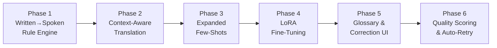

# Translator – Spoken Sinhala Quality Improvement Plan

## Current State Assessment

Your application currently:
- Uses **HelaLM-4B** (general-purpose Sinhala LLM) with few-shot examples
- Translates each subtitle line **independently** with no dialogue context
- Relies on a regex-based post-processor to strip model commentary
- Has no mechanism to detect or correct residual written Sinhala forms
- Has no user feedback loop or quality scoring

**Observed issues in current output:**

| English | Current Output | Issue |
|---|---|---|
| `I am preparing the report for the project.` | `මම ඒ ප්ලොස්ට් එක සූදානම් කරගෙන ඉන්නවා.` | "ප්ලොස්ට්" is a garbled transliteration of "project" — should use the actual loan word "ප්‍රොජෙක්ට්" |
| `Let's meet at the train station at 5 PM.` | `පස්වරු පහට අපි හමුවෙමු.` | "හමුවෙමු" is **written Sinhala** (-මු ending) — spoken form is "හමුවෙමු" → "හමුවෙමු**ද**" or "**හම්බවෙලා**" or "**හම්බවෙමු**" |

These are symptoms of three root problems: (1) the base model isn't fine-tuned for subtitle translation, (2) there's no dialogue context, and (3) there's no grammar validation pass.

---

## Improvement Plan — 6 Phases



---

## Phase 1: Written-to-Spoken Rule Engine (Post-Processor)

> [!IMPORTANT]
> **Impact: High** · **Effort: Low** · **No model changes required**

The single fastest win. Add a deterministic regex-based written-to-spoken converter that runs on every model output, catching literary verb forms the model still produces.

### What to build
A new module `anti_gravity/spoken_converter.py` with a rule table:

| Written Form (ලිඛිත) | Spoken Replacement (කථා) | Example |
|---|---|---|
| `-වෙමු` / `-මු` (1st person plural formal) | `-මු` → context-dependent: `-වෙමු` → `වෙමු` is sometimes OK, but `-කරමු` → `කරමු` → `කරමු`/`කරන්නම්කෝ` | `හමුවෙමු` → `හම්බවෙමු` |
| `-න්නේය` | `-නවා` | `යන්නේය` → `යනවා` |
| `-න්නෙමි` | `-න්නම්` | `කරන්නෙමි` → `කරන්නම්` |
| `-වේ` (formal copula) | `-වෙනවා` / `-යි` | `සිදුවේ` → `වෙනවා` |
| `-නැත` (formal negation) | `-නෑ` | `නැත` → `නෑ` |
| `-නොවේ` | `-නෙවෙයි` / `-නෑ` | `නොවේ` → `නෙවෙයි` |
| `ඔබ` (formal 'you') | `ඔයා` | `ඔබ` → `ඔයා` |
| `ඔහු` / `ඇය` | `එයා` | `ඔහු` → `එයා` |
| `ඔවුන්` | `ඒගොල්ලෝ` | `ඔවුන්` → `ඒගොල්ලෝ` |
| `-ද?` (literary question) | Context: sometimes fine, but `-ද?` at sentence end → `-ද?` or `-නවාද?` | — |

### Implementation sketch
```python
# anti_gravity/spoken_converter.py
import re

WRITTEN_TO_SPOKEN_RULES = [
    # Formal pronouns → spoken
    (r'\bඔබ\b', 'ඔයා'),
    (r'\bඔහු\b', 'එයා'),
    (r'\bඇය\b', 'එයා'),
    (r'\bඔවුන්\b', 'ඒගොල්ලෝ'),
    # Formal verb endings → spoken
    (r'න්නේය\b', 'නවා'),
    (r'න්නෙමි\b', 'න්නම්'),
    (r'නැත\b', 'නෑ'),
    (r'නොවේ\b', 'නෙවෙයි'),
    # More rules...
]

def convert_written_to_spoken(text: str) -> str:
    for pattern, replacement in WRITTEN_TO_SPOKEN_RULES:
        text = re.sub(pattern, replacement, text)
    return text
```

### Integration point
Call `convert_written_to_spoken()` inside `clean_sinhala_output()` as a final pass, after all stripping is done but before returning.

---

## Phase 2: Context-Aware Sliding Window Translation

> [!IMPORTANT]
> **Impact: High** · **Effort: Medium**

Currently each subtitle line is translated in complete isolation. This causes:
- **Pronoun confusion** — the model doesn't know who "he" or "she" refers to
- **Tone inconsistency** — a scene might shift between formal/informal randomly
- **Repetition** — the model may translate the same recurring phrase differently each time

### What to build
Feed the **previous N translated lines** as context alongside the current line:

```
[Previous context for reference — DO NOT re-translate these:]
Line 42: "Where are you going?" → "ඔයා කොහෙද යන්නේ?"
Line 43: "I'm going to the store." → "මම ෂොප් එකට යනවා."

[Translate this line:]
English subtitle: "Can you get me something?"
Spoken Sinhala:
```

### Implementation
1. Change `_format_prompt(self, text, context_lines=None)` to accept optional context
2. In `worker.py`, maintain a rolling buffer of the last 3–5 translated pairs per file
3. Pass the buffer to `translate_batch()` → `_format_prompt()`
4. Add a Settings toggle: **"Context Window Size"** (0 = off, 3, 5, 8)

### Why this works
The model sees the conversational flow and maintains consistent pronouns, tone, and vocabulary choices. This is how professional human translators work — they read the surrounding dialogue.

---

## Phase 3: Expanded & Categorized Few-Shot Examples

> [!TIP]
> **Impact: Medium** · **Effort: Low**

3 few-shot examples is the bare minimum. Expand to **10–15 diverse examples** covering different sentence types:

### Proposed categories

| Category | English | Spoken Sinhala |
|---|---|---|
| **Question** | `Where are you going?` | `ඔයා කොහෙද යන්නේ?` |
| **Negation** | `I don't know what happened.` | `මම දන්නේ නෑ මොකද වුණේ කියලා.` |
| **Command** | `Don't worry about it.` | `ඒ ගැන බය වෙන්න එපා.` |
| **Emotion/Exclamation** | `Oh my God, what have you done!` | `අනේ දෙයියනේ, ඔයා මොනවද කරලා තියෙන්නේ!` |
| **Past tense** | `She left without saying anything.` | `එයා මොකුත් නොකියා ගියා.` |
| **Future intent** | `I'll be there tomorrow morning.` | `මම හෙට උදේ එනවා.` |
| **Conditional** | `If you don't hurry, we'll be late.` | `ඔයා ඉක්මන් කරන්නැතිනම්, අපි ප්‍රමාද වෙනවා.` |
| **Slang/Colloquial** | `That's totally messed up.` | `ඒක හරිම ගොඩක් වෙලා.` |
| **Loan words** | `Send me the report by email.` | `ඒ report එක මට email කරන්න.` |
| **Multi-speaker** | `- Ready?\n- Let's go.` | `- ලෑස්තිද?\n- යමු.` |
| **Formal→Spoken** | `I sincerely apologize for the inconvenience.` | `ආ සොරි, අපහසුතාවයක් වුණානම්.` |

### Implementation
- Move `SPOKEN_FEW_SHOTS` to a JSON file (`data/few_shots.json`) so users can edit/add examples without touching code
- Add a Settings tab: **"Few-Shot Examples"** with add/edit/delete/import UI
- Dynamically sample a subset (e.g., 5–8) from the full pool to fit within token limits

---

## Phase 4: LoRA Fine-Tuning on Subtitle Pairs

> [!CAUTION]
> **Impact: Very High** · **Effort: High** · **This is the single biggest quality leap**

The base model (HelaLM-4B) was trained on general Sinhala text (news, Wikipedia, books). It has **never seen** movie subtitle translation pairs. Fine-tuning teaches it the *exact* task.

### Dataset creation
1. **Source**: Collect 1,000–5,000 English↔Sinhala subtitle pairs from:
   - Existing Sinhala-subtitled movies/TV shows (OpenSubtitles, Subscene, Baiscope.lk)
   - Manual curation — translate 200–500 lines yourself as gold-standard spoken Sinhala
   - Community contributions (add an "Export corrections" button to the app)
2. **Format**: JSONL file with chat template structure
   ```json
   {"messages": [
     {"role": "system", "content": "<system prompt>"},
     {"role": "user", "content": "English subtitle: Where are you going?\nSpoken Sinhala:"},
     {"role": "assistant", "content": "ඔයා කොහෙද යන්නේ?"}
   ]}
   ```
3. **Quality control**: Every pair must use spoken Sinhala — reject any with literary forms

### Training setup (fits on RTX 3060 12GB)
```python
# Using PEFT + QLoRA
from peft import LoraConfig, get_peft_model, prepare_model_for_kbit_training

lora_config = LoraConfig(
    r=16,              # rank
    lora_alpha=32,
    target_modules=["q_proj", "v_proj", "k_proj", "o_proj"],
    lora_dropout=0.05,
    task_type="CAUSAL_LM"
)
# Train with trl SFTTrainer
# ~2-4 hours on RTX 3060 for 2000 pairs, 3 epochs
```

### Integration
- Save the LoRA adapter separately (~50–100 MB)
- Load with `model.load_adapter("path/to/lora_adapter")`
- Add a Settings option: **"LoRA Adapter Path"** to load custom fine-tuned weights
- Ship a pre-trained adapter with the application

### Expected improvement
Fine-tuned models typically see **40–60% reduction in translation errors** for domain-specific tasks. The model will:
- Natively produce spoken verb forms without needing the rule engine
- Maintain consistent subtitle-appropriate brevity
- Handle loan words correctly (e.g., "project" → "ප්‍රොජෙක්ට්" not "ප්ලොස්ට්")

---

## Phase 5: Glossary System & User Correction UI

> [!NOTE]
> **Impact: Medium** · **Effort: Medium**

### 5A: Glossary / Terminology Database
A JSON lookup table that overrides or guides translations for specific terms:

```json
{
  "project": "ප්‍රොජෙක්ට්",
  "email": "ඊමේල්",
  "phone": "ෆෝන්",
  "computer": "කොම්පියුටර්",
  "train station": "දුම්රිය පොළ",
  "hospital": "හොස්පිට්ල්"
}
```

**Implementation**: Before sending to the model, scan the English line for glossary matches and inject a hint:
```
English subtitle: "Meet me at the train station."
Glossary: train station = දුම්රිය පොළ
Spoken Sinhala:
```

### 5B: Post-Translation Correction UI
Add an **inline editing mode** in the Live Preview panel:
- Click any translated line to edit it directly
- Edited lines are saved to a `corrections.jsonl` file
- These corrections can be:
  - Used as additional few-shot examples in future runs
  - Exported for LoRA fine-tuning dataset (Phase 4)
  - Applied as "translation memory" — if the same English phrase appears again, use the corrected version

---

## Phase 6: Automated Quality Scoring & Retry

> [!TIP]
> **Impact: Medium** · **Effort: Medium**

### Quality checks to implement

| Check | Method | Action on Failure |
|---|---|---|
| **Written form detection** | Regex scan for `-න්නේය`, `-න්නෙමි`, `ඔබ`, `ඔහු`, `-නැත`, etc. | Auto-apply Phase 1 rule engine |
| **Length ratio** | If Sinhala output is >3× or <0.3× the English length | Flag for review / retry with lower temperature |
| **Empty or unchanged** | Output is blank or identical to English input | Retry up to 2× with temperature bump |
| **Script purity** | >20% of output is Latin/English characters (excluding loan words) | Retry |
| **Repetition** | Model generates repetitive tokens (e.g., "නවා නවා නවා") | Retry with `repetition_penalty=1.2` |

### Implementation
```python
def score_translation(english: str, sinhala: str) -> tuple[float, list[str]]:
    """Returns (score 0-1, list of issue descriptions)"""
    issues = []
    score = 1.0
    
    # Check for written forms
    written_patterns = ['න්නේය', 'න්නෙමි', r'\bඔබ\b', r'\bඔහු\b', 'නැත']
    for pat in written_patterns:
        if re.search(pat, sinhala):
            issues.append(f"Written form detected: {pat}")
            score -= 0.15
    
    # Length ratio check
    ratio = len(sinhala) / max(len(english), 1)
    if ratio > 3.0 or ratio < 0.3:
        issues.append(f"Abnormal length ratio: {ratio:.1f}")
        score -= 0.2
    
    return max(score, 0), issues
```

### UI integration
- Show a quality badge (🟢 Good / 🟡 Review / 🔴 Poor) next to each translated line
- Filter the preview to show only 🔴 lines for quick review
- Add "Retry Failed" button that re-translates only poor-scoring lines

---

## Implementation Priority & Timeline

| Phase | Impact | Effort | Recommended Order |
|---|---|---|---|
| **Phase 1** — Written→Spoken Rule Engine | 🟢 High | 🟢 Low (~2 hrs) | **Do first** |
| **Phase 3** — Expanded Few-Shots | 🟡 Medium | 🟢 Low (~1 hr) | **Do second** |
| **Phase 2** — Context Window | 🟢 High | 🟡 Medium (~4 hrs) | **Do third** |
| **Phase 6** — Quality Scoring & Retry | 🟡 Medium | 🟡 Medium (~3 hrs) | **Do fourth** |
| **Phase 5** — Glossary & Correction UI | 🟡 Medium | 🟡 Medium (~4 hrs) | **Do fifth** |
| **Phase 4** — LoRA Fine-Tuning | 🟢🟢 Very High | 🔴 High (~days) | **Do when dataset ready** |

> [!TIP]
> Phases 1 + 3 alone (just a few hours of work) will noticeably improve output quality. Phase 4 (LoRA) is the ultimate goal but requires dataset preparation time.

---

## Bonus: Alternative Model Considerations

| Model | Params | Why Consider | Tradeoff |
|---|---|---|---|
| **Gemma 2 9B** (fine-tuned) | 9B | Excellent instruction following, Sinhala in pretraining data | Needs ~6GB VRAM at 4-bit |
| **Llama 3.1 8B** (fine-tuned) | 8B | State-of-art base, strong multilingual | Needs LoRA for Sinhala |
| **MADLAD-400 3B** | 3B | Google's massively multilingual translation model | Seq2seq, already trained on translation |
| **NLLB-3.3B** | 3.3B | Larger NLLB with better Sinhala | ~4GB VRAM, fast |

The best path forward is to **LoRA fine-tune your existing HelaLM-4B** on curated subtitle pairs rather than switching models — it already has strong Sinhala knowledge, it just needs task-specific alignment.

