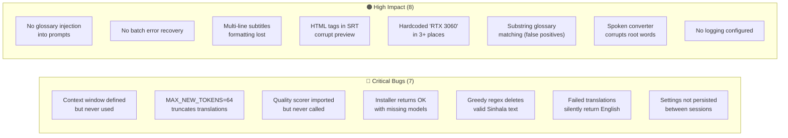
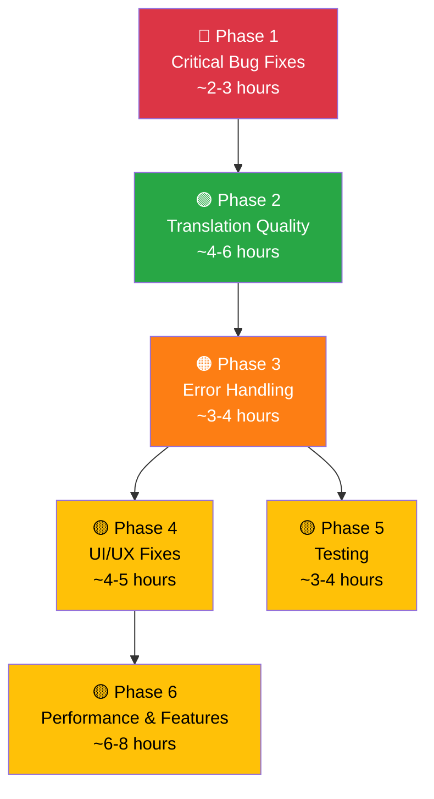

# Sinhala Subtitle Translator — Comprehensive Improvement Plan v2

> [!IMPORTANT]
> This plan supersedes [IMPROVEMENT_PLAN.md](file:///G:/Ai/Sinhala Subtitle Translator/IMPROVEMENT_PLAN.md). It covers **every bug, quality issue, and missing feature** discovered from a full codebase audit. Each phase is designed to be executed independently.

---

## Audit Summary



---

## Phase 1 — Critical Bug Fixes ✅ COMPLETED
> **Impact: 🔴 Critical** · **Effort: Low (2–3 hours)** · ~~Execute first~~ **DONE**

These are bugs that actively produce wrong output or crash the app. Fix all of them before any feature work.

### 1.1 Wire up the context window (translator_engine.py)

**Bug:** `context_window_size = 3` is defined in `__init__` but **never passed to prompt formatting**. Every subtitle line is translated in complete isolation.

**Fix:**
- In `translate_batch()`, maintain a rolling list of the last N `(english, sinhala)` pairs
- Pass them to `_build_prompt()` / `_format_prompt()` as context lines
- Format them in the prompt as:
  ```
  [Previous dialogue for context — do NOT re-translate:]
  "Where are you going?" → "ඔයා කොහෙද යන්නේ?"
  "I'm going home." → "මම ගෙදර යනවා."
  
  [Translate ONLY this line:]
  English: "Can you wait for me?"
  Spoken Sinhala:
  ```
- Reset the context buffer at each new file

**Files:** [translator_engine.py](file:///G:/Ai/Sinhala Subtitle Translator/anti_gravity/translator_engine.py)

---

### 1.2 Increase MAX_NEW_TOKENS from 64 to 196

**Bug:** Sinhala Unicode text is verbose — a 10-word English sentence can easily need 80–120+ tokens in Sinhala. At 64 tokens, translations are silently truncated mid-word.

**Fix:**
- Change `DEFAULT_MAX_NEW_TOKENS` from `64` to `196` in [config.py](file:///G:/Ai/Sinhala Subtitle Translator/anti_gravity/config.py)
- Add a token-length sanity check: if generated output hits exactly `max_new_tokens`, log a warning that it may be truncated
- Expose this setting in the settings dialog with a range of 64–512

---

### 1.3 Activate quality scoring and add retry logic

**Bug:** `score_translation_quality()` from `spoken_converter.py` is imported in `translator_engine.py` but **never called**. Bad translations pass through with no flagging or retry.

**Fix:**
- After each line is translated and cleaned, call `score_translation_quality(english, sinhala)`
- If score < 0.4 (🔴 Poor), retry translation up to 2 times with slightly increased temperature (+0.1 per retry)
- If still poor after retries, keep the best-scoring attempt and emit a warning signal
- Pass the score through the worker signal so the preview widget can show it (it already has badge rendering)
- Log all low-score translations to a `translation_issues.log` file

**Files:** [translator_engine.py](file:///G:/Ai/Sinhala Subtitle Translator/anti_gravity/translator_engine.py), [worker.py](file:///G:/Ai/Sinhala Subtitle Translator/anti_gravity/worker.py)

---

### 1.4 Fix installer_wizard `run_checks()` return value

**Bug:** `run_checks()` returns `len(self.missing_pkgs) == 0` but **ignores `missing_models`**. If packages are installed but models are missing, it returns `True` and translation proceeds — then crashes.

**Fix:**
- Change return to `len(self.missing_pkgs) == 0 and len(self.missing_models) == 0`
- Add explicit model weight file verification (check for `model.safetensors` or `pytorch_model.bin`, not just `config.json`)

**File:** [installer_wizard.py](file:///G:/Ai/Sinhala Subtitle Translator/anti_gravity/ui/installer_wizard.py)

---

### 1.5 Fix greedy parenthetical regex eating valid text

**Bug:** Line 81 of translator_engine.py: `re.sub(r"\s*[\(\[][^\)\]]*[\)\]].*", "", text)` — the `.*` after the closing bracket is greedy and **deletes everything after the first parenthetical expression**, including valid Sinhala text.

**Fix:**
- Remove the trailing `.*`: `re.sub(r"\s*[\(\[][^\)\]]*[\)\]]", "", text)`
- Or limit to content: `re.sub(r"\s*[\(\[][^\)\]]{10,}[\)\]]", "", text)` (only remove parentheticals >10 chars, which are likely model notes)

**File:** [translator_engine.py](file:///G:/Ai/Sinhala Subtitle Translator/anti_gravity/translator_engine.py)

---

### 1.6 Handle failed translations properly (don't silently return English)

**Bug:** When translation produces zero Sinhala characters, `clean_sinhala_output` returns the original English text. The user sees English in the "translated" output with no warning.

**Fix:**
- Instead of returning `original_input`, return a marked placeholder: `"⚠️ " + original_input`
- Add a `translation_failures` counter to the worker that counts these
- Show a summary dialog after translation completes: "X out of Y lines failed to translate"
- In the preview widget, highlight failed lines with a red background
- Add a "Retry Failed Lines" button that only re-translates lines with the ⚠️ marker

**Files:** [translator_engine.py](file:///G:/Ai/Sinhala Subtitle Translator/anti_gravity/translator_engine.py), [worker.py](file:///G:/Ai/Sinhala Subtitle Translator/anti_gravity/worker.py), [main_window.py](file:///G:/Ai/Sinhala Subtitle Translator/anti_gravity/ui/main_window.py)

---

### 1.7 Add settings persistence

**Bug:** All settings are stored only in memory. Closing the app loses every setting change.

**Fix:**
- Save settings to a JSON file in the user's app data directory (`%APPDATA%/SinhalaSubtitleTranslator/settings.json`)
- Load settings on startup, merge with defaults for any new keys
- Save on dialog close, not on every change
- Include config migration: if a key is renamed between versions, map old → new

**Files:** [settings_dialog.py](file:///G:/Ai/Sinhala Subtitle Translator/anti_gravity/ui/settings_dialog.py), [main_window.py](file:///G:/Ai/Sinhala Subtitle Translator/anti_gravity/ui/main_window.py)

---

## Phase 2 — Translation Quality Improvements ✅ COMPLETED
> **Impact: 🟢 High** · **Effort: Medium (4–6 hours)** · ~~Execute second~~ **DONE**

These changes directly improve the quality of translated Sinhala subtitle output.

### 2.1 Inject glossary terms into the LLM prompt

**Current:** Glossary is only used for post-processing string replacement in translated output. The LLM has no knowledge of preferred translations.

**Fix:**
- In `_build_prompt()`, scan the English input for glossary matches
- Inject relevant terms into the prompt:
  ```
  [Glossary — use these exact translations:]
  project = ප්‍රොජෙක්ට්
  email = ඊමේල්
  
  English subtitle: "Send me the project report by email."
  Spoken Sinhala:
  ```
- Limit to max 8 glossary terms per prompt to avoid consuming too much context window
- Keep post-processing glossary replacement as a safety net

**Files:** [translator_engine.py](file:///G:/Ai/Sinhala Subtitle Translator/anti_gravity/translator_engine.py), [glossary.py](file:///G:/Ai/Sinhala Subtitle Translator/anti_gravity/glossary.py)

---

### 2.2 Fix glossary substring matching (false positives)

**Bug:** `term.lower() in text.lower()` matches substrings. The term `"he"` matches `"the"`, `"she"`, `"there"`, etc. This causes wrong glossary terms to be injected into prompts and wrong replacements in post-processing.

**Fix:**
- Use word-boundary regex matching: `re.search(r'\b' + re.escape(term) + r'\b', text, re.IGNORECASE)`
- Sort terms by length (longest first) before applying replacements to prevent shorter terms from breaking longer phrases (e.g., "New York" before "York")
- In `apply_glossary`, use `re.sub(r'\b' + re.escape(term) + r'\b', translation, text, flags=re.IGNORECASE)` to respect word boundaries

**File:** [glossary.py](file:///G:/Ai/Sinhala Subtitle Translator/anti_gravity/glossary.py)

---

### 2.3 Preserve multi-line subtitle structure

**Bug:** Two-line subtitles (common in SRT for readability) lose their line breaks during translation. The model receives `"Line 1\nLine 2"` as a single string and may output a single long line.

**Fix:**
- Before translation, split multi-line entries and translate each line separately (preserving the `\n` structure)
- OR: instruct the model in the prompt to preserve line breaks:
  ```
  If the English subtitle has multiple lines (separated by \n), output the same number of lines in Sinhala.
  ```
- After translation, enforce the SRT subtitle line length limit (~42 characters per line, max 2 lines per entry)
- If a translated line exceeds 42 characters, auto-wrap at a natural break point (space between words)

**Files:** [translator_engine.py](file:///G:/Ai/Sinhala Subtitle Translator/anti_gravity/translator_engine.py), [subtitle_parser.py](file:///G:/Ai/Sinhala Subtitle Translator/anti_gravity/subtitle_parser.py)

---

### 2.4 Fix spoken converter over-aggressive suffix replacement

**Bug:** The spoken converter applies suffix rules to ALL words, including words where the suffix is part of the root (not a formal verb ending). E.g., a word naturally ending in "ය" gets converted even when it's not a formal marker.

**Fix:**
- Add a **whitelist of protected words** that should never be converted (common nouns/proper nouns ending in convertible suffixes)
- Add minimum word length requirements for suffix rules (e.g., only apply "ය"→"එ" to words ≥4 characters)
- Use the `regex` library's Unicode word boundary support (`\b`) more carefully around each rule
- Add a `known_spoken_forms` set — if the word is already a known spoken form, skip it

**File:** [spoken_converter.py](file:///G:/Ai/Sinhala Subtitle Translator/anti_gravity/spoken_converter.py)

---

### 2.5 Expand few-shot examples to 12+ covering all sentence types

**Current:** Only 4 few-shot examples, all basic declarative sentences.

**Fix:**
- Add examples for: questions, negations, commands/imperatives, exclamations, past tense, future intent, conditionals, multi-speaker lines (`- Ready?\n- Let's go.`), lines with loan words
- Move examples from hardcoded in `config.py` to a JSON file `data/few_shots.json` so users can edit without touching code
- Dynamically sample 6–8 examples per prompt (rotating which examples are used to avoid the model parroting the same few-shot)
- Ensure examples fit within token budget

**Files:** [config.py](file:///G:/Ai/Sinhala Subtitle Translator/anti_gravity/config.py), new file `data/few_shots.json`

---

### 2.6 Add subtitle-specific output validation

After translation and cleaning, validate each subtitle entry for SRT compliance:

| Check | Rule | Action |
|---|---|---|
| **Max line length** | ≤ 42 characters per line | Auto-wrap at word boundary |
| **Max lines per entry** | ≤ 2 lines | Truncate/reflow to 2 lines |
| **Reading speed** | 15–25 CPS (characters per second) | Warn if too fast for the subtitle duration |
| **Empty translation** | Output is blank or whitespace | Flag for retry |
| **Length ratio** | Sinhala/English ratio between 0.3× and 3× | Flag abnormal ratios for review |
| **Repetition** | Same token/phrase repeated 3+ times | Strip repetitions, flag for review |
| **SRT formatting tags** | `<i>`, `<b>`, `<font>` preserved | Re-apply tags from original if stripped |

**New file:** `anti_gravity/subtitle_validator.py`

---

## Phase 3 — Error Handling & Robustness ✅ COMPLETED
> **Impact: 🟠 High** · **Effort: Medium (3–4 hours)** · ~~Execute third~~ **DONE**

### 3.1 Add batch error recovery with partial save

**Bug:** If one batch fails (e.g., CUDA OOM), the entire file is marked "Failed" and all already-translated lines are lost.

**Fix:**
- Wrap each batch translation in its own try/except
- On OOM: halve the batch size and retry that batch
- On other errors: skip the batch, mark those entries as failed, continue with the next batch
- Save partial progress: write the output file with whatever was successfully translated, marking failed entries
- Show a summary: "Translated 980/1000 lines. 20 lines failed (batches 15, 22)."

**Files:** [worker.py](file:///G:/Ai/Sinhala Subtitle Translator/anti_gravity/worker.py), [translator_engine.py](file:///G:/Ai/Sinhala Subtitle Translator/anti_gravity/translator_engine.py)

---

### 3.2 Configure logging throughout the application

**Bug:** `logging.getLogger()` is used in multiple files but no handler is ever configured. All logs are silently discarded.

**Fix:**
- In `anti_gravity/main.py`, add `logging.basicConfig()` with:
  - Console handler (INFO level)
  - File handler (`%APPDATA%/SinhalaSubtitleTranslator/app.log`, DEBUG level, rotating 5MB × 3 files)
- Log important events: model load/unload, translation start/complete, errors, quality scores, glossary matches
- Add a "View Logs" option in the Help menu

**File:** [main.py](file:///G:/Ai/Sinhala Subtitle Translator/anti_gravity/main.py)

---

### 3.3 Add global exception handler

**Bug:** Unhandled exceptions in the UI thread crash the app silently with no user feedback.

**Fix:**
- Set `sys.excepthook` to a custom handler that:
  - Logs the full traceback
  - Shows a `QMessageBox.critical()` dialog with the error message
  - Offers to save the log file for reporting
- Also set `threading.excepthook` for worker thread crashes

**File:** [main.py](file:///G:/Ai/Sinhala Subtitle Translator/anti_gravity/main.py)

---

### 3.4 Protect TranslationEngine initialization

**Bug:** `TranslationEngine()` constructor in `main_window.py` has no try/except. If PyTorch/CUDA is missing or broken, the app crashes with an opaque error.

**Fix:**
- Wrap in try/except with a user-friendly error dialog
- Check for CUDA availability before offering GPU device option
- Validate model file exists and is a valid format before attempting load
- Show a progress dialog during model loading (can take 30–60 seconds)

**File:** [main_window.py](file:///G:/Ai/Sinhala Subtitle Translator/anti_gravity/ui/main_window.py)

---

### 3.5 Fix SRT parser edge cases

| Edge Case | Current Behavior | Fix |
|---|---|---|
| `.` decimal separator (instead of `,`) | Parse fails | Accept both `,` and `.` |
| BOM marker in file | First index may fail to parse | Strip BOM before parsing |
| Mixed `\r\n` / `\n` line endings | Block splitting may fail | Normalize line endings before split |
| Positioning tags after timestamp | Parse fails | Strip positioning tags before parsing |
| Overlapping timestamps | Silently accepted | Log warning |
| Non-sequential indices | Silently accepted | Re-number on output |
| Empty file | Returns empty list silently | Warn user |

**File:** [subtitle_parser.py](file:///G:/Ai/Sinhala Subtitle Translator/anti_gravity/subtitle_parser.py)

---

## Phase 4 — UI/UX Improvements ✅ COMPLETED
> **Impact: 🟡 Medium** · **Effort: Medium (4–5 hours)** · ~~Execute fourth~~ **DONE**

### 4.1 Remove hardcoded "RTX 3060" — dynamically detect GPU

**Bug:** "RTX 3060" is hardcoded in at least 3 files: [bottom_bar.py](file:///G:/Ai/Sinhala Subtitle Translator/anti_gravity/ui/bottom_bar.py), [resource_monitor_widget.py](file:///G:/Ai/Sinhala Subtitle Translator/anti_gravity/ui/resource_monitor_widget.py), and the device combo.

**Fix:**
- Use `torch.cuda.get_device_name(0)` or `pynvml` to detect actual GPU name
- Fall back to "GPU" if detection fails
- Update all 3+ hardcoded references

---

### 4.2 Escape HTML in live preview widget

**Bug:** SRT files commonly contain `<i>`, `<b>`, `<font>` tags. These are inserted into the preview's HTML without escaping, so they render as formatting instead of displaying literally.

**Fix:**
- Use `html.escape()` on both `en_text` and `si_text` before inserting into the HTML template
- Consider showing a small indicator when the original subtitle contains formatting tags

**File:** [live_preview_widget.py](file:///G:/Ai/Sinhala Subtitle Translator/anti_gravity/ui/live_preview_widget.py)

---

### 4.3 Add memory limit to preview widget

**Bug:** Preview text is appended indefinitely. For large files (3000+ entries), the QTextEdit becomes sluggish and consumes excessive memory.

**Fix:**
- Implement a circular buffer of the last 500 entries
- When buffer is full, remove the oldest block of HTML before appending new
- Add a "Show All" toggle that disables the limit (with a performance warning)
- Add an "Export Preview" button that saves the full translation log to a text file

**File:** [live_preview_widget.py](file:///G:/Ai/Sinhala Subtitle Translator/anti_gravity/ui/live_preview_widget.py)

---

### 4.4 Prevent duplicate files and show file status badges

**Current:** Same file can be added multiple times; no visual status per file.

**Fix:**
- Check for duplicates on add (by absolute path) — show a toast notification if duplicate detected
- Add status column with badges: ⏳ Pending → 🔄 Processing → ✅ Done → ❌ Failed
- Show a per-file completion percentage
- Disable add/remove/reorder while translation is running
- Show file count and estimated total time in the bottom bar

**File:** [file_queue_widget.py](file:///G:/Ai/Sinhala Subtitle Translator/anti_gravity/ui/file_queue_widget.py)

---

### 4.5 Add input validation to settings dialog

**Fix:**
- Add `QIntValidator` / `QDoubleValidator` to all numeric fields
- Clamp ranges: GPU layers (0–999), batch size (1–64), temperature (0.0–2.0), max tokens (32–1024), context window (0–10), threads (1–CPU count)
- Validate model path is a file that exists
- Warn if system prompt is empty
- Disable settings that require model reload while translation is running

**File:** [settings_dialog.py](file:///G:/Ai/Sinhala Subtitle Translator/anti_gravity/ui/settings_dialog.py)

---

### 4.6 Fix double `run_checks()` execution

**Bug:** `InstallerWizardDialog` is instantiated in `start_queue()` just to call `run_checks()`, but `__init__` also calls `run_checks()` internally — checks run twice.

**Fix:**
- Make `run_checks()` callable without instantiating the full wizard
- Or add a flag to skip auto-check in `__init__` when called from `start_queue()`

**Files:** [main_window.py](file:///G:/Ai/Sinhala Subtitle Translator/anti_gravity/ui/main_window.py), [installer_wizard.py](file:///G:/Ai/Sinhala Subtitle Translator/anti_gravity/ui/installer_wizard.py)

---

## Phase 5 — Testing & Reliability ✅ COMPLETED
> **Impact: 🟡 Medium** · **Effort: Medium (3–4 hours)** · ~~Execute fifth~~ **DONE**

### 5.1 Fix existing broken tests

| Test File | Issue | Fix |
|---|---|---|
| `test_pipeline.py` | Calls `clean_sinhala_output` with 1 arg; current function needs 2 | Update to match current signature |
| `test_pipeline.py` | Hardcoded relative path `"test_sample.srt"` | Use `Path(__file__).parent / "test_sample.srt"` |
| `test_clean_filter.py` | Not a proper unittest; uses bare `assert` | Convert to `unittest.TestCase` or `pytest` |
| `test_sample_out.srt` | Contains known quality issues (ප්ලොස්ට්) | Update expected output to match current system |

---

### 5.2 Add comprehensive unit tests

| Module | Tests Needed |
|---|---|
| `subtitle_parser.py` | BOM handling, mixed encodings, malformed SRT, empty file, positioning tags, `.` vs `,` decimal |
| `glossary.py` | Word boundary matching, case sensitivity, term ordering, empty glossary, large glossary performance |
| `spoken_converter.py` | Protected words, root word preservation, double-conversion, empty input, already-spoken text |
| `translator_engine.py` | Prompt formatting with context, prompt formatting with glossary, output cleaning edge cases, hallucination detection thresholds, `_is_mostly_sinhala` with various ratios |
| `subtitle_validator.py` (new) | Line length enforcement, CPS calculation, repetition detection, tag preservation |

### 5.3 Add an integration test with mock model

- Create a mock `TranslationEngine` that returns predetermined translations
- Test the full pipeline: parse → batch → translate → validate → write
- Verify output SRT is valid and playable
- Test with edge-case SRT files: empty, huge (5000 entries), multi-line, HTML tags, Unicode edge cases

---

## Phase 6 — Performance & Advanced Features ✅ COMPLETED
> **Impact: 🟡 Medium** · **Effort: High (6–8 hours)** · ~~Execute last~~ **DONE**

### 6.1 Smart batching by scene boundaries

**Current:** Batches are formed by simple sequential splitting (`entries[i:i+batch_size]`), which can split mid-dialogue.

**Fix:**
- Detect scene boundaries by looking for timestamp gaps > 2 seconds between consecutive subtitles
- Prefer to break batches at scene boundaries
- Keep rapid-fire dialogue (gaps < 0.5s) in the same batch for better context

**File:** [worker.py](file:///G:/Ai/Sinhala Subtitle Translator/anti_gravity/worker.py)

---

### 6.2 Expand the glossary system

- Expand from 36 to 200+ entries covering common movie/TV vocabulary
- Add categories: character names (transliterated), places, technical terms, common phrases
- Add context-dependent entries: `"right"` → `"හරි"` (correct) vs `"දකුණ"` (direction) — use surrounding context to disambiguate
- Add user glossary management UI: add/edit/delete/import/export terms
- Support per-project glossaries (load a movie-specific glossary alongside the global one)

**Files:** [glossary.py](file:///G:/Ai/Sinhala Subtitle Translator/anti_gravity/glossary.py), [glossary.json](file:///G:/Ai/Sinhala Subtitle Translator/anti_gravity/data/glossary.json)

---

### 6.3 Add post-translation review UI

- Add a side-by-side view of original English ↔ translated Sinhala
- Click any line to edit the translation inline
- Save corrections to `corrections.jsonl` for future LoRA training data
- Add "Apply All Corrections" to regenerate the output file with manual edits
- Implement a "Translation Memory": if the same English phrase appears in a future file, suggest the corrected translation

---

### 6.4 Update build_exe.py for working executables

**Current:** Missing CUDA libraries, glossary data, `regex` module, `accelerate` data — produced executable will crash.

**Fix:**
- Add `--collect-all=torch` for CUDA DLLs
- Add `--hidden-import=regex`
- Add `--add-data "anti_gravity/data;anti_gravity/data"` for glossary and few-shots
- Add `--collect-data=accelerate`
- Add `--collect-data=pynvml`
- Test the built exe on a clean machine without Python installed

**File:** [build_exe.py](file:///G:/Ai/Sinhala Subtitle Translator/build_exe.py)

---

### 6.5 Update documentation

| Document | Updates Needed |
|---|---|
| `README.md` | Update project structure (add spoken_converter, glossary.json, etc.); sync system prompt with config.py; add troubleshooting section; add model compatibility info |
| `IMPROVEMENT_PLAN.md` | Mark Phases 1 & 6 as completed; update to reference this v2 plan |
| `translator.md` | Update default model name; fix truncated content; align app name |

---

## Execution Order Summary



| Phase | Items | Est. Time | Depends On |
|---|---|---|---|
| **Phase 1** — Critical Bug Fixes | 7 items | 2–3 hrs | None |
| **Phase 2** — Translation Quality | 6 items | 4–6 hrs | Phase 1 |
| **Phase 3** — Error Handling | 5 items | 3–4 hrs | Phase 1 |
| **Phase 4** — UI/UX Improvements | 6 items | 4–5 hrs | Phase 1 |
| **Phase 5** — Testing | 3 items | 3–4 hrs | Phase 1–3 |
| **Phase 6** — Performance & Advanced | 5 items | 6–8 hrs | Phase 1–4 |

> [!TIP]
> **Quick wins:** Phases 1.2 (increase max tokens), 1.5 (fix regex), and 2.2 (fix glossary matching) can each be done in under 15 minutes and will immediately improve output quality. Start there.

